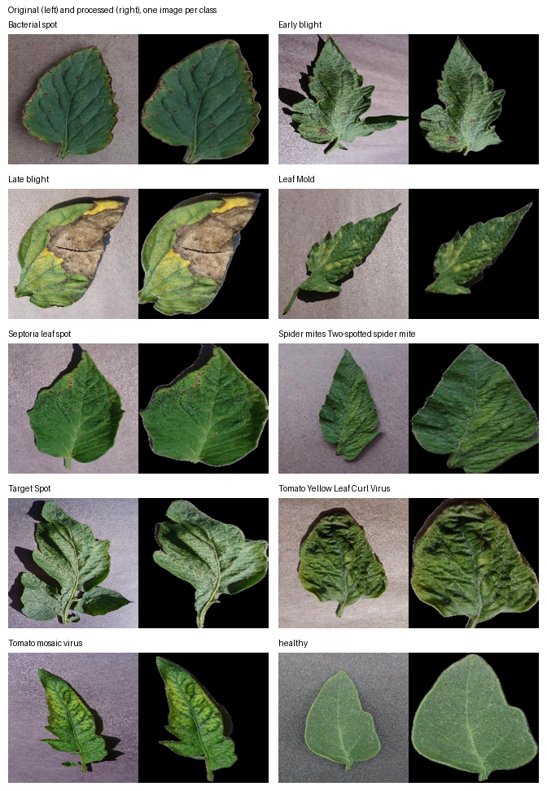

# Tomato Leaf Disease Dataset: Preprocessing Pipeline

Code that builds the Kaggle dataset **[PlantVillage Tomato Leaves - Background Removed](https://www.kaggle.com/datasets/tarunrai9/plantvillage-tomato-leaves-bg-removed)**.

It takes the tomato subset of PlantVillage (18,160 images, 10 classes), crops every leaf with a YOLOv8 detector, removes the background with U2-Net, resizes to 224x224, and splits the result into train / val / test **by near-duplicate groups**, so photos of the same leaf never end up on both sides of the split.



## Why a group-aware split?

PlantVillage contains many near-identical photos of the same leaf. With a plain random per-image split, copies of one leaf land in both train and test, and test accuracy looks better than it really is. On the first random split of this data, **14.5% of test images had a near-duplicate or very similar image in train** (cosine similarity >= 0.94 of ResNet50 features). In the final split that number is 0%.

## The dataset at a glance

| | |
|---|---|
| Images | 18,146 (14 of 18,160 dropped because no leaf was detected) |
| Classes | 10 (9 diseases + healthy) |
| Image size | 224 x 224 RGB JPEG, black background |
| Split | 12,702 train / 2,724 val / 2,720 test |
| Augmentation | None |
| License | CC BY-SA 3.0 (same as PlantVillage) |

Full details, per-class counts and known limitations are on the Kaggle page and in `metadata/`.

## Pipeline

```
raw PlantVillage tomato images (18,160)
  |  1. src/split_tomato_dataset.py   first random train/val/test split (replaced in step 3)
  v
  |  2. src/preprocess_dataset.py     YOLO leaf crop + U2-Net background removal + resize 224x224
  v                                   (14 images without a detected leaf are dropped)
processed images (18,146)
  |  3. src/dedup_resplit.py          ResNet50 embeddings -> near-duplicate groups -> group-aware split
  v
final dataset (12,702 / 2,724 / 2,720)
```

Helper scripts: `src/audit_counts.py` (counts per stage and the list of dropped images), `src/build_manifest.py` (md5 manifest and exact-duplicate check), `src/make_sample_grid.py` (the picture above).

## Setup

Python 3.9 or newer.

```bash
git clone TODO_GITHUB_URL
cd tomato-leaf-disease-preprocessed
pip install -r requirements.txt
```

Step 2 needs two model weight files and the U2-Net model definition. See [`models/README.md`](models/README.md). Step 3 only needs `torch`, `torchvision`, `numpy`, `scipy` and `pillow`; it downloads the ResNet50 ImageNet weights automatically on first use.

## Reproduce

Put the 10 tomato class folders of the **color** version of PlantVillage in `data/raw_dataset/`, then:

```bash
# 1. first split (the published run was unseeded; a seed is optional)
python src/split_tomato_dataset.py --source data/raw_dataset --dest data/tomato_disease_cnn --seed 42

# 2. crop leaves, remove backgrounds
python src/preprocess_dataset.py --input data/tomato_disease_cnn --output data/processed

# 3. near-duplicate analysis and group-aware split (run from the repo root or a scratch folder)
python src/dedup_resplit.py embed   --root data/processed        # about 10-20 min on CPU, once
python src/dedup_resplit.py analyze                              # leakage per similarity threshold
python src/dedup_resplit.py preview --threshold 0.94             # check pairs by eye
python src/dedup_resplit.py resplit --threshold 0.94 --dry-run   # new counts, copies nothing
python src/dedup_resplit.py resplit --threshold 0.94 --out data/final_dataset

# optional
python src/audit_counts.py --raw data/raw_dataset --split data/tomato_disease_cnn --processed data/processed
python src/make_sample_grid.py --raw data/raw_dataset --processed data/final_dataset
```

`dedup_resplit.py` never modifies its input: `resplit` copies images into the new folder and writes `metadata/split_manifest.csv` (with a group id for every image) and `metadata/split_params.txt`.

**About exact reproducibility.** Step 1 of the published run was not seeded, so the first split cannot be recreated. That does not matter for the final dataset: the final split depends only on the processed images, the ResNet50 features, the threshold (0.94) and the seed (42). `metadata/split_manifest.csv` is the authoritative record of which image is in which split. Tiny floating-point differences between machines could change borderline similarities, so re-running may move a few images.

## How the 0.94 threshold was chosen

For each threshold, images of the same class with cosine similarity above it are linked into groups. Measured on the first random split:

| Threshold | Groups | Images in groups of 2+ | Largest group | Test images with a look-alike in train |
|---:|---:|---:|---:|---:|
| 0.90 | 7,328 | 61.9% | 3,678 | 58.4% |
| 0.92 | 11,825 | 38.3% | 1,881 | 34.8% |
| **0.94** | **15,766** | **16.5%** | **471** | **14.5%** |
| 0.96 | 17,655 | 4.1% | 89 | 3.3% |
| 0.98 | 18,122 | 0.3% | 2 | 0.2% |

Below 0.94, different leaves get chained into huge groups (one group of 1,881 images at 0.92). In a visual check of 16 image pairs just above and 16 just below 0.94 (`dedup_resplit.py preview`), roughly a third of the pairs just above were clearly the same leaf (mostly distinctive diseased leaves), many of the others were different but similar-looking healthy leaves, and most pairs just below were different leaves. No single threshold separates look-alike healthy leaves from real duplicates of distinctive (for example yellow-curl) leaves, so 0.94 deliberately errs on the side of grouping too much. That can only keep more similar images together; it cannot cause leakage.

## Repository layout

```
src/            pipeline and helper scripts
examples/       detect_leaf.py, an inference demo (not used to build the dataset)
models/         where to put the model weights (not stored in the repo)
metadata/       class_counts.csv, split_manifest.csv, split_params.txt, dropped_images.csv
assets/         sample_grid.png
```

## Limitations

- Class imbalance is inherited from PlantVillage (Yellow Leaf Curl Virus about 30% of images, Mosaic virus about 2%).
- Near-duplicate grouping is approximate: some true duplicates below the threshold can still cross splits, and some different but similar leaves are grouped together.
- PlantVillage photos are lab images; models may do worse on field photos.
- Background masks were not checked image by image.

## License

The code in this repository is released under the [MIT License](LICENSE). The dataset it produces is derived from PlantVillage and is released under CC BY-SA 3.0. Third-party credits and licenses are listed in [ATTRIBUTION.md](ATTRIBUTION.md).

## Citation

See [CITATION.cff](CITATION.cff). If you use the data, please also cite the original PlantVillage paper:

> Hughes, D. P. and Salathe, M. (2015). An open access repository of images on plant health to enable the development of mobile disease diagnostics. arXiv:1511.08060.
